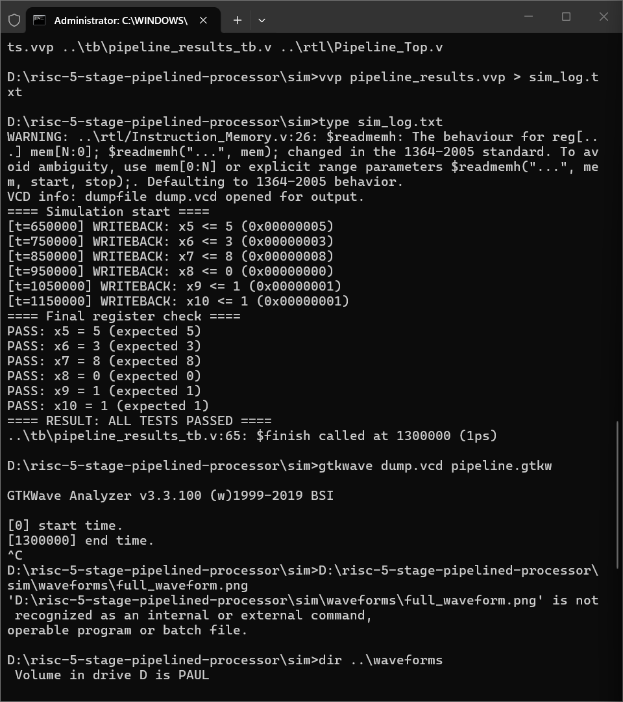
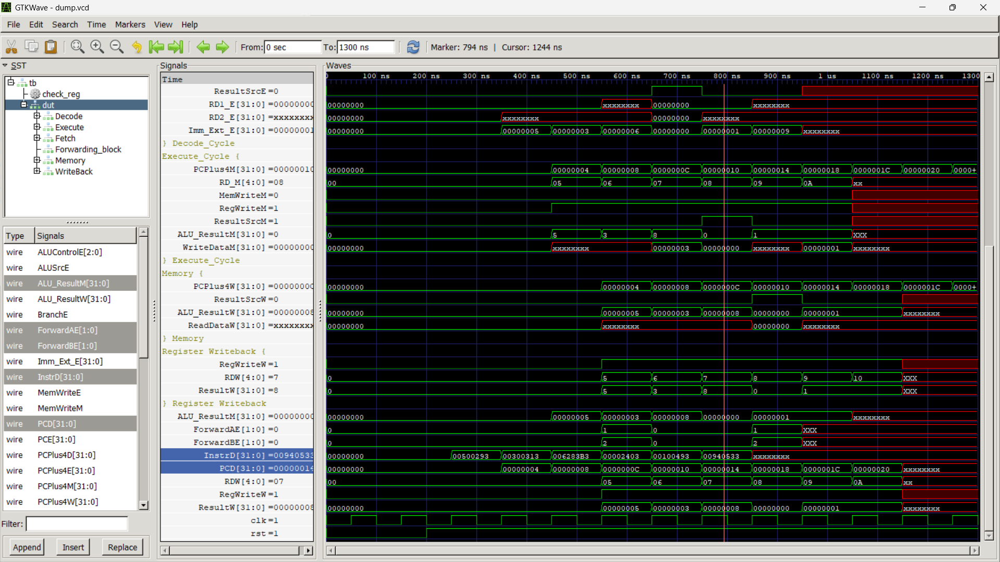
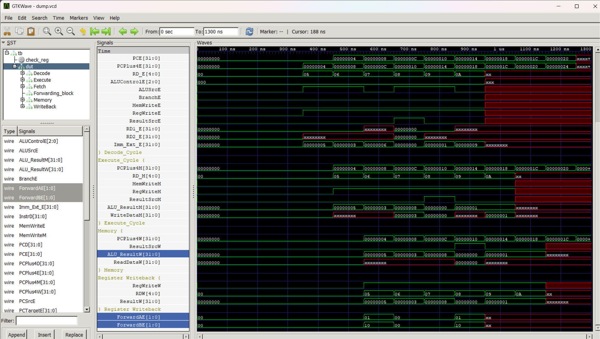
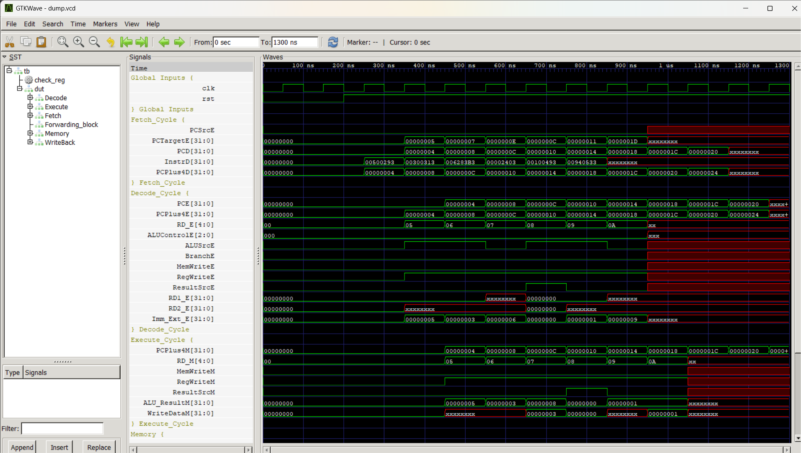
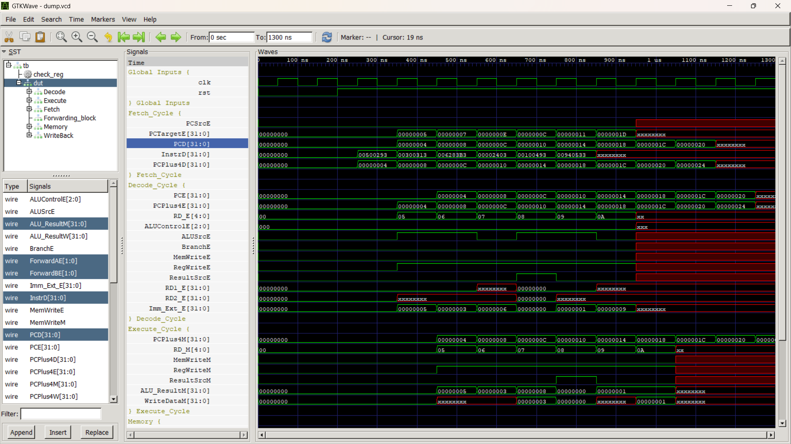
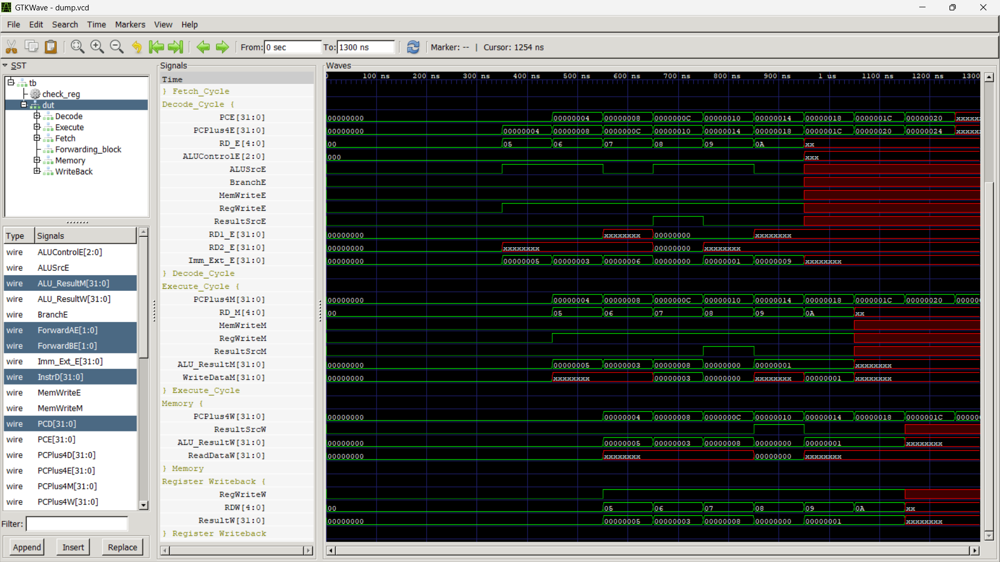

# 5-Stage Pipelined RISC-V Processor (Verilog): Verification and Hazard Handling

A 32-bit RISC-V (RV32I subset) processor with a classic 5-stage pipeline (IF, ID, EX, MEM, WB), written in Verilog.
This repository contains the core, four self-checking testbenches, simulation logs and waveforms, and the bug fixes and hazard handling I added.

## Credits

The base RTL design is the open-source core by **MERL-DSU** (Apache License 2.0): https://github.com/merldsu/RISCV_Pipeline_Core

All original copyright headers are kept. Every change I made is marked with a `Modified by Gershon Paul Kolanti` comment below the original header.

## My contribution

- Set up the toolchain (Icarus Verilog, GTKWave, Git) and ran the design from scratch
- Wrote **four self-checking testbenches** that log every write-back and check the final register values (PASS/FAIL)
- Found and fixed **two bugs** in the original core (branch immediate, register file write-through)
- Added **branch flush** and **load-use stall**
- Analyzed the waveforms, including data forwarding, and documented the design and its limitations
- Synthesized and implemented the core in Vivado (Artix-7) and analyzed utilization and timing: 100 MHz timing met

## Architecture

| Stage | Files |
|---|---|
| Instruction Fetch (IF) | `Fetch_Cycle.v`, `PC.v`, `PC_Adder.v`, `Instruction_Memory.v` |
| Instruction Decode (ID) | `Decode_Cyle.v`, `Control_Unit_Top.v`, `Main_Decoder.v`, `ALU_Decoder.v`, `Register_File.v`, `Sign_Extend.v` |
| Execute (EX) | `Execute_Cycle.v`, `ALU.v` |
| Memory (MEM) | `Memory_Cycle.v`, `Data_Memory.v` |
| Write-Back (WB) | `Writeback_Cycle.v` |
| Forwarding unit | `Hazard_unit.v` |
| Top level | `Pipeline_Top.v` |

**Supported instructions:** R-type (add, sub, slt, or, and), `addi`, `lw`, `sw`, and `beq`.

## Hazard handling

| Hazard | Example | Solution |
|---|---|---|
| Data (read after write) | `add x7,x5,x6` right after the instructions that write x5, x6 | Forwarding from the MEM and WB stages to EX (original design) |
| Data, 3 instructions apart | Decode reads a register that write-back is writing in the same cycle | Register file **write-through** (my fix) |
| Load-use | `lw x6` followed immediately by `add x7,x6,x6` | **One-cycle stall**: PC and IF/ID hold, a bubble enters EX (my addition) |
| Control | Taken `beq` | **Flush** of the two wrong-path instructions, 2-cycle penalty (my addition) |

## Changes to the original design

| File | Change |
|---|---|
| `rtl/Sign_Extend.v` | Bug fix: added the B-type (branch) immediate. Before, `ImmSrc = 10` returned 0, so a taken `beq` jumped to `PC + 0`. |
| `rtl/Register_File.v` | Bug fix: write-through (WB to ID bypass). Before, decode read stale data when write-back wrote the same register in the same cycle, and forwarding did not cover it. |
| `rtl/Fetch_Cycle.v`, `rtl/Decode_Cyle.v`, `rtl/Pipeline_Top.v` | Branch flush (`PCSrcE` clears IF/ID and ID/EX) and load-use stall (`StallD` holds the PC and IF/ID and inserts a bubble into ID/EX). Both are synchronous clears kept outside the asynchronous reset, so they synthesize correctly. `Pipeline_top` also has a new `Result_out` port so the synthesis tool keeps the logic. |

## Tests

Each test has its own program (`memfile.hex`) and testbench. Run each one from its own folder, because `Instruction_Memory.v` loads `memfile.hex` by relative path.

| Test | Folder | Testbench | What it checks |
|---|---|---|---|
| Basic and forwarding | `sim` | `tb/pipeline_results_tb.v` | 6-instruction program, forwarding, x5 to x10 |
| Branch (`beq`) | `sim/branch_test` | `tb/branch_tb.v` | Taken and not-taken `beq`, B-type immediate, write-through |
| Branch flush | `sim/flush_test` | `tb/flush_tb.v` | Wrong-path instructions behind a taken `beq` must not write registers (no NOP padding) |
| Load-use stall | `sim/stall_test` | `tb/stall_tb.v` | A dependent instruction right after a `lw` gets the loaded value |

The flush and stall tests fail on the unmodified pipeline and pass with the fixes:

- Flush test without the flush: `x11 = 11` and `x12 = 12` (expected 1), because the wrong-path instructions executed.
- Stall test without the stall: `x7 = 0` and `x10 = 5` (expected 10), because the `add` used the load address instead of the loaded data.

### Basic test program

| # | Hex | Instruction | Expected |
|---|---|---|---|
| 1 | `00500293` | `addi x5, x0, 5` | x5 = 5 |
| 2 | `00300313` | `addi x6, x0, 3` | x6 = 3 |
| 3 | `006283B3` | `add x7, x5, x6` | x7 = 8 (forwarding) |
| 4 | `00002403` | `lw x8, 0(x0)` | x8 = 0 |
| 5 | `00100493` | `addi x9, x0, 1` | x9 = 1 |
| 6 | `00940533` | `add x10, x8, x9` | x10 = 1 (forwarding) |

## How to simulate

Tools: [Icarus Verilog](https://bleyer.org/icarus/) and GTKWave. Commands for Windows PowerShell, from the repository root:
cd sim
iverilog -I ..\rtl -o pipeline_results.vvp ..\tb\pipeline_results_tb.v ..\rtl\Pipeline_Top.v
vvp pipeline_results.vvp > sim_log.txt

cd branch_test
iverilog -I ....\rtl -o branch.vvp ....\tb\branch_tb.v ....\rtl\Pipeline_Top.v
vvp branch.vvp > sim_log.txt

cd ..\flush_test
iverilog -I ....\rtl -o flush.vvp ....\tb\flush_tb.v ....\rtl\Pipeline_Top.v
vvp flush.vvp > sim_log.txt

cd ..\stall_test
iverilog -I ....\rtl -o stall.vvp ....\tb\stall_tb.v ....\rtl\Pipeline_Top.v
vvp stall.vvp > sim_log.txt

Each run ends with `==== RESULT: ALL TESTS PASSED ====`. The waveform is written to `dump.vcd` and can be opened with `gtkwave dump.vcd`. A `$readmemh` warning from `Instruction_Memory.v` is harmless.

## Results

Logs: `sim/sim_log.txt`, `sim/branch_test/sim_log.txt`, `sim/flush_test/sim_log.txt`, `sim/stall_test/sim_log.txt`.

Basic test, all six register checks pass:

Full waveform of the basic test (write-back values and forwarding controls):

Forwarding in action: `ForwardAE`/`ForwardBE` become non-zero when `add x7` and `add x10` execute:

Additional waveform screenshots:

**Pipeline overview**: clock, reset, PC and the six fetched instructions (`InstrD`)

**Signal tree and selection** used for the analysis (PC, instruction, ALU result, forwarding)

**Decode to write-back stages**: destination registers (`RDW`) and written values (`ResultW`)

## FPGA synthesis and timing (Vivado)

The core was synthesized and implemented with Vivado (2026.x) for the Artix-7 on the Digilent Basys 3 (`xc7a35tcpg236-1`).

| File | Purpose |
|---|---|
| `fpga/fpga_top.v` | Wrapper: button to active-low reset, write-back result XOR-folded onto 16 LEDs so the tool keeps the whole core |
| `fpga/constraints.xdc` | 100 MHz clock constraint and Basys 3 pins |
| `fpga/run_vivado.tcl` | Batch flow: synthesis, place and route, reports |
| `fpga/reports/` | Utilization and timing reports (`*_20ns.rpt` is an earlier run at a 20 ns target) |

Run from the repository root: `vivado -mode batch -source fpga/run_vivado.tcl`

| Resource | Used | Available | Utilization |
|---|---|---|---|
| Slice LUTs | 855 | 20,800 | 4.11 % |
| LUT as Logic | 299 | 20,800 | 1.44 % |
| LUT as Memory (distributed RAM) | 556 | 9,600 | 5.79 % |
| Slice registers | 281 | 41,600 | 0.68 % |
| Block RAM / DSP | 0 / 0 | 50 / 90 | 0 % |

**Timing at a 10 ns (100 MHz) clock constraint:** setup slack (WNS) +2.337 ns, hold slack (WHS) +0.058 ns, 0 failing endpoints out of 5921. All user-specified timing constraints are met. The slowest path is about 7.7 ns, which suggests a maximum clock of roughly 130 MHz (an estimate from the slack, not a guaranteed limit).

Notes:
- The instruction memory holds only the 6-instruction program from `sim/memfile.hex`. The results describe this configuration.
- Most of the "LUT as Memory" comes from the 1024-word data memory and the register file, which are asynchronous-read memories built from distributed RAM. Only 299 LUTs are processor logic.
- The design was not tested on a physical board.

## Known limitations

- Only `lw`, `sw`, R-type (add, sub, slt, or, and), `addi` and `beq` are supported and tested. Other branch types, jumps, `lui` and `auipc` are not.
- A taken branch costs 2 cycles (resolved in the EX stage).
- Data memory is indexed directly by the byte address, so only aligned word accesses are meaningful.
- Verified in simulation (Icarus Verilog) and synthesized in Vivado, but not yet run on a physical board.

## License

Apache License 2.0 (see `LICENSE`). Original design copyright 2023 MERL-DSU.
